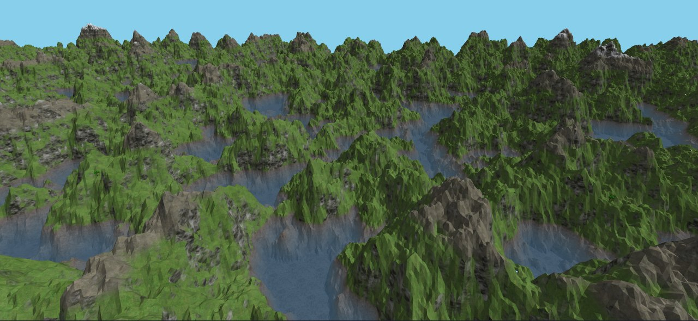
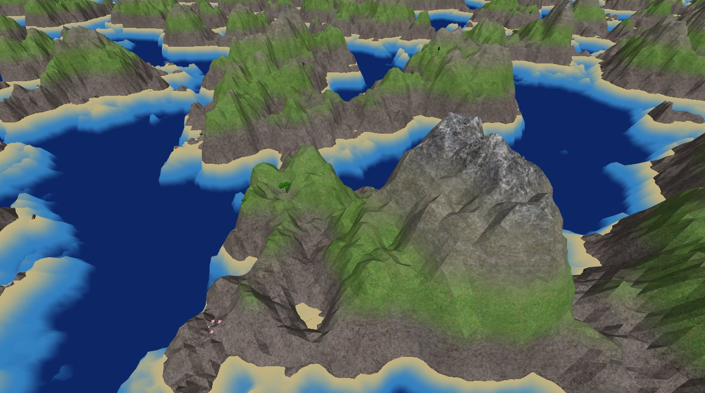
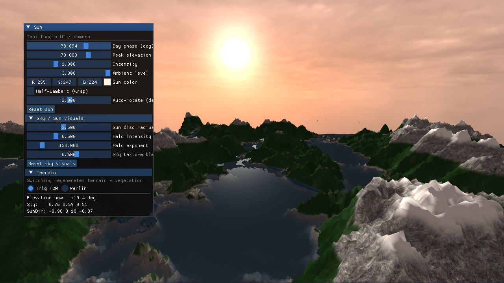

# Procedural Terrain Renderer (C++ / OpenGL)

An infinite 3D landscape generated from noise and streamed in chunks around the camera, built by a team of three. My part was the vegetation system, the terrain materials and a performance pass. The pass cut plant geometry to about 30% and vertex throughput by about 40%.

**English** · [中文](README.zh-CN.md)

> This repository presents a team course project (Advanced Computer Graphics, Chalmers University of Technology, spring 2026). The code is not public because it includes my teammates' work.

  
   <em>Final build: terrain, materials and vegetation streamed in chunks around the camera.</em>

## Results

- **Vegetation that follows the terrain.** Trees, shrubs and flowers are placed by biome, height and slope, drawn with GPU instancing and streamed with the terrain chunks.
- **Terrain materials by height and slope.** A 7-layer texture chain runs from gravel to snow, with rock on steep slopes and a textured seabed under the water.
- **Lighter rendering.** The performance pass cut plant geometry to about 30%, vertex throughput by about 40% and tree fragment cost by about 67%. These are estimates from geometry and texture-fetch counts; frame rates were not measured.

## My part

**Vegetation.**
- Placement on a per-chunk grid filtered by a deterministic hash and a low-frequency Perlin density map, so dense forest and open meadow alternate.
- Three plant types with their own height ranges: trees, shrubs and flowers.
- Procedural geometry built into vertex buffers, then L-system trees with textured trunks and crowns. About 20% of trees are scaled up 1.8 times for variety.
- Plant height sampled from the rendered terrain surface, so plants sit on the ground instead of floating.
- Chunks load and unload in step with the terrain's chunk manager. Each species is drawn with one instanced call per chunk.

**Terrain materials.**
- Triplanar texturing with five textures: dirt, grass, dry grass or stone on top faces, chosen by height, and cliff rock on the sides.
- Slope decides rock or land; height plus two layers of value noise decide the grass, dry-grass and snow bands, so the bands are not flat lines.
- Per-vertex smooth normals computed from the height field, which removed visible triangle edges at the grass and rock boundary.
- Under water, the seabed is textured and darkened with Beer–Lambert absorption, exp(−0.08 · depth), blended over ±1 m at the shore.

  
   <em>Materials during development: grass on gentle slopes, rock on steep ones, sand at the shore.</em>

**Performance pass.**

| Change | Before | After |
|---|---|---|
| Vegetation chunks in range (render radius 5 → 3) | 81 | 29 |
| Plant candidates per chunk | 533 | 282 |
| Triangles per tree (geometry LOD) | about 380 | about 250 |
| Texture fetches per tree fragment | 6 | 2 |
| Terrain chunks in range (radius 5 → 4) | 81 | about 52 |
| Noise octaves for slope lookups during plant placement | 6 | 3 |

Combined, plant geometry fell to about 30% of the previous version, vertex throughput by about 40% and tree fragment cost by about 67%.

## Team

The terrain generator, camera, sky and sun were built by one teammate, and the water by the other. The image below shows their sky, sun and water together with the terrain.

  
   <em>Team build at sunset: sky, sun and water by my teammates.</em>

## Tech stack

- **Languages:** C++, GLSL
- **Libraries:** OpenGL, GLFW, GLM, CMake, stb_image
- **Techniques:** Perlin noise and fBm, chunk streaming, GPU instancing, L-systems, triplanar mapping, Beer–Lambert absorption, geometry LOD

## Limitations

- Performance gains are estimates from geometry and texture-fetch counts; no frame-rate benchmark was run.
- Vegetation uses a fixed set of procedural plant types.

## Links

- Portfolio: https://tjiewgnil.github.io/#terrain
