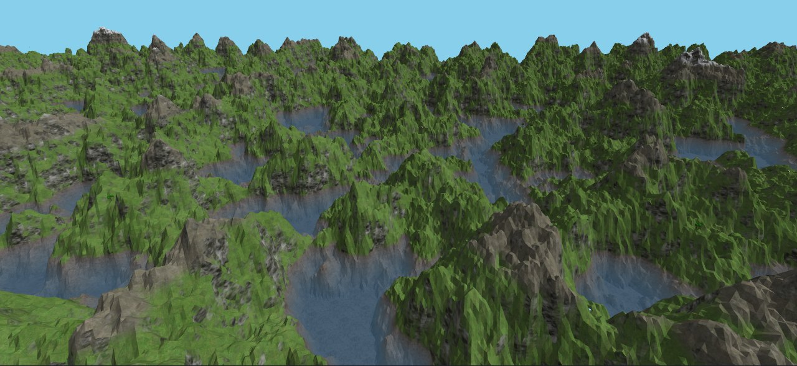
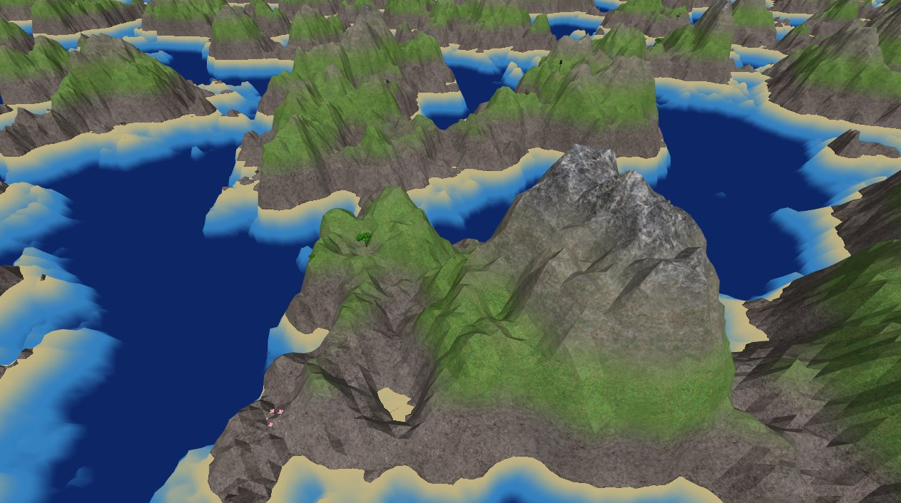
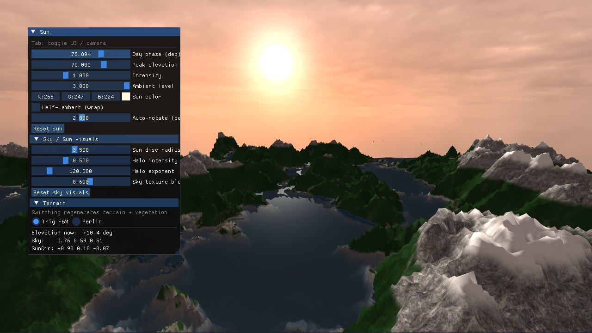

# 程序化地形渲染器（C++ / OpenGL）

由噪声生成、围绕相机按区块加载的无限 3D 地形，由 3 人小组完成。我负责植被系统、地形材质和一轮性能优化。优化后植物几何量降到约 30%，顶点吞吐量降低约 40%。

[English](README.md) · **中文**

> 本仓库展示一个小组课程项目（查尔姆斯理工大学"高级计算机图形学"，2026 年春季）。代码包含队友的工作，因此不公开。

  
   <em>最终版本：地形、材质和植被围绕相机按区块加载。</em>

## 成果

- **植被贴合地形。** 乔木、灌木和花按生物群落、高度和坡度放置，用 GPU 实例化绘制，随地形区块一起加载。
- **按高度和坡度变化的地形材质。** 7 层纹理从砾石过渡到雪，陡坡显示岩石，水下有带纹理的海床。
- **渲染开销更低。** 性能优化把植物几何量降到约 30%，顶点吞吐量降低约 40%，树的片元开销降低约 67%。这些是按几何量和纹理采样次数的估算，没有实测帧率。

## 我负责的部分

**植被。**
- 在每个区块的网格上放置植物，用确定性哈希和低频 Perlin 密度图筛选，让茂密的森林和开阔的草地交替出现。
- 三类植物各有自己的高度区间：乔木、灌木和花。
- 先用写入顶点缓冲的程序化几何，再改为 L-system 生成的树，树干和树冠带贴图。约 20% 的树放大 1.8 倍，增加层次。
- 植物高度从实际渲染的地形表面采样，植物贴着地面，不再悬空。
- 区块的加载和卸载与地形的区块管理器同步。每种植物在每个区块用一次实例化调用绘制。

**地形材质。**
- 5 张纹理的三平面映射：顶面按高度选泥土、草、干草或石头，侧面用悬崖岩石。
- 坡度决定岩石还是陆地；高度加两层值噪声决定草地、干草和雪的分布，分界不是一条水平线。
- 从高度场计算逐顶点平滑法线，消除了草地和岩石交界处明显的三角形边缘。
- 水下的海床带纹理，并按 Beer–Lambert 定律随深度变暗，exp(−0.08 · 深度)，在岸边 ±1 m 内平滑过渡。

  
   <em>开发过程中的材质效果：缓坡是草地，陡坡是岩石，岸边是沙滩。</em>

**性能优化。**

| 改动 | 之前 | 之后 |
|---|---|---|
| 范围内的植被区块（渲染半径 5 → 3） | 81 | 29 |
| 每个区块的候选植物 | 533 | 282 |
| 每棵树的三角形（几何 LOD） | 约 380 | 约 250 |
| 树的每个片元的纹理采样次数 | 6 | 2 |
| 范围内的地形区块（半径 5 → 4） | 81 | 约 52 |
| 放置植物时坡度查询的噪声层数 | 6 | 3 |

综合下来，植物几何量降到上一版的约 30%，顶点吞吐量降低约 40%，树的片元开销降低约 67%。

## 小组分工

地形生成、相机、天空和太阳由一位队友完成，水面由另一位队友完成。下图展示了他们做的天空、太阳和水面与地形的合成效果。

  
   <em>小组版本的日落场景：天空、太阳和水面由队友完成。</em>

## 技术栈

- **语言：** C++、GLSL
- **库：** OpenGL、GLFW、GLM、CMake、stb_image
- **技术：** Perlin 噪声与 fBm、区块流式加载、GPU 实例化、L-system、三平面映射、Beer–Lambert 吸收、几何 LOD

## 局限

- 性能提升是按几何量和纹理采样次数的估算，没有做帧率基准测试。
- 植被只有固定的几类程序化植物。

## 链接

- 作品集：https://tjiewgnil.github.io/zh/#terrain
